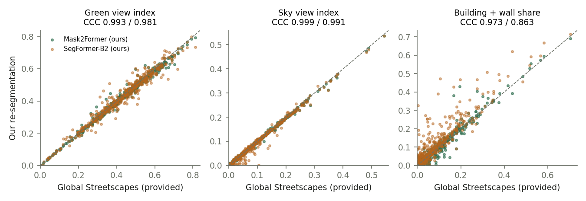
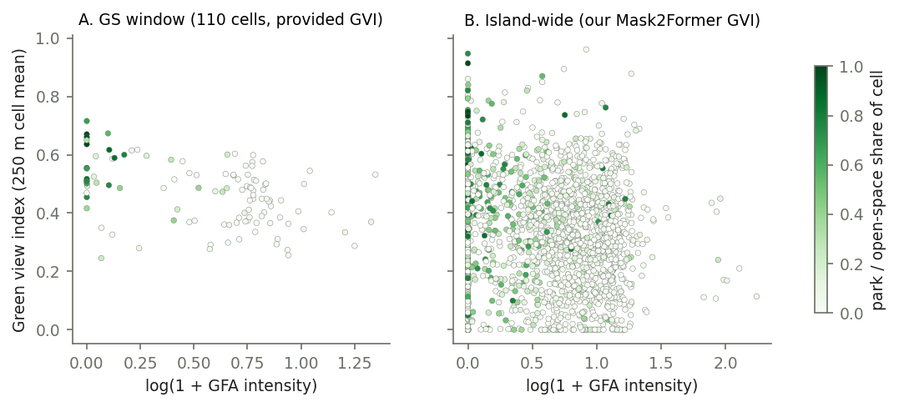
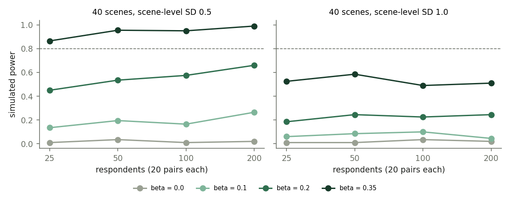

# sg-streetscape-density

How do street-level greenery, sky and building façades vary with built density
in Singapore, and how would we test whether greenery makes density *feel*
softer? This repository takes three steps:

1. **Reproduce the dataset values, then extend coverage.** We re-segmented
   Global Streetscapes images with our own GPU run and checked our values
   against the ones the dataset provides. We then applied the same model to an
   island-wide KartaView sample.
2. **Link to density.** We joined both image sets to open density proxies
   (URA Master Plan 2019 plot ratios, HDB building footprints) on a 250 m
   grid. We fitted mixed and cluster-robust models, compared them with
   spatially blocked cross-validation, and listed "softened density"
   candidate cells.
3. **Design the perception test.** This step is a pairwise-comparison survey
   instrument (a static page) with a pre-registration-style protocol,
   Bradley–Terry and TrueSkill scoring code, and a simulation-based power
   analysis.

> **Independent personal project** by Wenjie Luo (NUS MSc Civil Engineering,
> Transport). It is **not affiliated with** the Singapore-ETH Centre or the
> NUS Urban Analytics Lab, and is not part of the "Mind the density" project.
> **No survey responses have been collected.** The survey page is a demo that
> stores and sends nothing, and the pilot has not been run.

* Map and survey demo (GitHub Pages): <https://luoaini1213.github.io/sg-streetscape-density/>
* Write-up (PDF): [`docs/paper.pdf`](docs/paper.pdf); survey protocol: [`docs/protocol.md`](docs/protocol.md)

Every result number below sits inside an `<!--n:key-->` tag. CI recomputes it
from the committed `outputs/` (`python -m scripts.check_numbers`).

## Data and what was actually accessible

| Source | What we used | Licence |
|---|---|---|
| **Global Streetscapes** (Hou et al. 2024), `NUS-UAL/global-streetscapes` on Hugging Face | Tabular attributes for all Singapore rows: Mask2Former class pixel counts, GVI/SVI, contextual labels, Place Pulse-style perception predictions, OSM road attributes. Read with DuckDB HTTP range requests, no account needed. | CC BY-SA 4.0 |
| **KartaView** imagery | Public 1280×720 thumbnails. (a) The Global Streetscapes KartaView rows (URLs are in `metadata_kv`). (b) An island-wide sample through the public `api.kartaview.org/2.0/photo` endpoint. No account or token was used. | CC BY-SA 4.0 |
| URA **Master Plan 2019 Land Use** (data.gov.sg) | Parcel land use and gross plot ratio (GPR) | Singapore Open Data Licence v1.0 |
| **HDB Existing Building** (data.gov.sg) | HDB block footprints (coverage) | Singapore Open Data Licence v1.0 |
| URA MP2019 Subzone / Planning Area boundaries | Land mask and names | Singapore Open Data Licence v1.0 |

What we found on access:

* **Global Streetscapes covers only a small window of Singapore.** All
  <!--n:gs_sg_images-->22,327<!--/n--> Singapore images
  (<!--n:gs_kv_images-->9,977<!--/n--> KartaView,
  <!--n:gs_mly_images-->12,350<!--/n--> Mapillary) fall inside a ~2.4 × 2.4 km
  box around the city reference point (1.30 N, 103.80 E). That box spans
  Tanglin, Queenstown and Bukit Timah. The density link on the dataset's own
  attributes ("Tier A") is therefore local: it contrasts landed-housing
  Tanglin with high-rise Queenstown and Holland. The island-wide KartaView
  sample ("Tier B") exists to lift this limit.
* **Mapillary images need an access token**, so we did not download them; we
  use their provided attributes only. KartaView images are public, so all our
  own segmentation runs on KartaView photos.
* **OSM building footprints were deliberately not used** for density. ODbL
  share-alike and CC BY-SA 4.0 are not mutually compatible, which would make a
  combined redistributable cell table awkward. All density inputs therefore
  come from the Singapore Open Data Licence, which only asks for attribution.
  Global Streetscapes' own OSM road-class field is used as a model covariate
  but is not republished.
* Two quirks of the dataset matter for anyone reusing it:
  * Its `datetime_local` column for KartaView rows equals KartaView's UTC
    `shotDate`, while its `hour` column is local.
  * Its contextual classifier labels some Singapore images "snowy".

Raw downloads go to `data/raw/` and images to `data/images/`. Both are
git-ignored and recreated by the scripts.

## Results

### 1. Our segmentation reproduces the dataset values (deep-learning step)

We picked <!--n:agree_n-->477<!--/n--> Global Streetscapes KartaView images
(daytime, good quality, ≤ 8 per 250 m cell). We ran them through two
pretrained models on a 4 GB GTX 1650 (fp16, batch 1):
Mask2Former Swin-L trained on Mapillary Vistas (the same label set as the
dataset), and SegFormer-B2 trained on Cityscapes (a different architecture and
different training data). The table compares our values with the provided
ones. Bias is ours minus the dataset's; MAE is in index units.

| index | Mask2Former vs dataset: CCC / MAE / bias | SegFormer vs dataset: CCC / MAE / bias |
|---|---|---|
| Green view index | <!--n:agree_gvi_gs_vs_m2f_ccc-->0.993<!--/n--> / <!--n:agree_gvi_gs_vs_m2f_mae-->0.012<!--/n--> / <!--n:agree_gvi_gs_vs_m2f_bias-->-0.007<!--/n--> | <!--n:agree_gvi_gs_vs_segf_ccc-->0.981<!--/n--> / <!--n:agree_gvi_gs_vs_segf_mae-->0.019<!--/n--> / <!--n:agree_gvi_gs_vs_segf_bias-->-0.004<!--/n--> |
| Sky view index | <!--n:agree_svi_gs_vs_m2f_ccc-->0.999<!--/n--> / <!--n:agree_svi_gs_vs_m2f_mae-->0.003<!--/n--> / <!--n:agree_svi_gs_vs_m2f_bias-->-0.000<!--/n--> | <!--n:agree_svi_gs_vs_segf_ccc-->0.991<!--/n--> / <!--n:agree_svi_gs_vs_segf_mae-->0.006<!--/n--> / <!--n:agree_svi_gs_vs_segf_bias-->-0.003<!--/n--> |
| Building + wall share | <!--n:agree_building_share_gs_vs_m2f_ccc-->0.973<!--/n--> / <!--n:agree_building_share_gs_vs_m2f_mae-->0.011<!--/n--> / <!--n:agree_building_share_gs_vs_m2f_bias-->+0.001<!--/n--> | <!--n:agree_building_share_gs_vs_segf_ccc-->0.863<!--/n--> / <!--n:agree_building_share_gs_vs_segf_mae-->0.032<!--/n--> / <!--n:agree_building_share_gs_vs_segf_bias-->+0.027<!--/n--> |



How to read the table:

* With the same label set, our run reproduces the provided indices almost
  exactly (Lin's CCC). The small residual differences are what you would
  expect from our 1280×720 thumbnails versus the dataset's full-resolution
  input.
* GVI and SVI are robust to the choice of model.
* Building share is not. SegFormer/Cityscapes calls more pixels "building"
  (bias above), so building-share values from different models should not be
  pooled.

### 2. Density link

**Tier A: Global Streetscapes window** (provided attributes,
<!--n:win_images_used-->22,104<!--/n--> daytime images in
<!--n:win_cells-->110<!--/n--> cells with ≥ 5 images each). The density proxy
is log(1 + GFA intensity), where GFA intensity = Σ(parcel GPR × parcel area)
within a cell ÷ cell area. Landed-housing parcels ("LND") are assigned GPR 1.4.
Parcels marked "EVA" (evaluated case by case) or "SDP" contribute nothing. The
table gives the coefficient on that proxy (95% CI). The adjusted models control
for park/open-space and residential land shares, walking vs driving platform,
source, side view, major road and year.

| outcome | mixed model, density only | mixed model, adjusted | adjusted, landed parcels excluded | adjusted, image-level OLS with cell-clustered SEs |
|---|---|---|---|---|
| GVI | <!--n:win_gvi_density_only_b-->-0.123<!--/n--> <!--n:win_gvi_density_only_ci-->[-0.173, -0.073]<!--/n--> | <!--n:win_gvi_adjusted_b-->-0.080<!--/n--> <!--n:win_gvi_adjusted_ci-->[-0.139, -0.021]<!--/n--> | <!--n:win_gvi_adjusted_nolanded_b-->-0.064<!--/n--> <!--n:win_gvi_adjusted_nolanded_ci-->[-0.108, -0.020]<!--/n--> | <!--n:win_gvi_adjusted_ols_clustered_b-->-0.009<!--/n--> <!--n:win_gvi_adjusted_ols_clustered_ci-->[-0.089, +0.071]<!--/n--> |
| SVI | <!--n:win_svi_density_only_b-->+0.000<!--/n--> <!--n:win_svi_density_only_ci-->[-0.027, +0.027]<!--/n--> | <!--n:win_svi_adjusted_b-->-0.012<!--/n--> <!--n:win_svi_adjusted_ci-->[-0.045, +0.021]<!--/n--> | <!--n:win_svi_adjusted_nolanded_b-->-0.011<!--/n--> <!--n:win_svi_adjusted_nolanded_ci-->[-0.036, +0.014]<!--/n--> | <!--n:win_svi_adjusted_ols_clustered_b-->-0.027<!--/n--> <!--n:win_svi_adjusted_ols_clustered_ci-->[-0.073, +0.018]<!--/n--> |
| Building share | <!--n:win_building_share_density_only_b-->+0.085<!--/n--> <!--n:win_building_share_density_only_ci-->[+0.060, +0.109]<!--/n--> | <!--n:win_building_share_adjusted_b-->+0.063<!--/n--> <!--n:win_building_share_adjusted_ci-->[+0.033, +0.092]<!--/n--> | <!--n:win_building_share_adjusted_nolanded_b-->+0.050<!--/n--> <!--n:win_building_share_adjusted_nolanded_ci-->[+0.028, +0.072]<!--/n--> | <!--n:win_building_share_adjusted_ols_clustered_b-->+0.034<!--/n--> <!--n:win_building_share_adjusted_ols_clustered_ci-->[-0.005, +0.073]<!--/n--> |

**Tier B: island-wide** (our Mask2Former values on
<!--n:isl_images-->2,580<!--/n--> KartaView photos in
<!--n:isl_cells-->1,868<!--/n--> cells across
<!--n:isl_pas-->53<!--/n--> planning areas).

* The candidate photos were sampled from
  <!--n:isl_api_photos-->12,804<!--/n--> API results: 08:00–17:59 local time,
  2015 or later, non-panoramic, at most 2 per cell from distinct sequences.
  <!--n:isl_downloaded-->2,580<!--/n--> of them were downloaded.
* All downloaded photos were segmented on the shared GTX 1650.
  The run used a seeded random processing order, so that a run stopped early
  would still leave a simple random subsample; the analysis keeps only the
  fully processed prefix of that order (`ssd/sampling.py`), which here is the
  whole set.

The models are image-level OLS with SEs clustered by 2 km block
(<!--n:isl_blocks-->168<!--/n--> blocks). The adjusted model adds HDB footprint
coverage, park, residential and road land shares, and year.

| outcome | density only | adjusted |
|---|---|---|
| GVI | <!--n:isl_gvi_density_only_b-->-0.064<!--/n--> <!--n:isl_gvi_density_only_ci-->[-0.090, -0.038]<!--/n--> | <!--n:isl_gvi_adjusted_b-->-0.060<!--/n--> <!--n:isl_gvi_adjusted_ci-->[-0.088, -0.032]<!--/n--> |
| SVI | <!--n:isl_svi_density_only_b-->-0.046<!--/n--> <!--n:isl_svi_density_only_ci-->[-0.072, -0.020]<!--/n--> | <!--n:isl_svi_adjusted_b-->-0.015<!--/n--> <!--n:isl_svi_adjusted_ci-->[-0.052, +0.022]<!--/n--> |
| Building share | <!--n:isl_building_share_density_only_b-->+0.104<!--/n--> <!--n:isl_building_share_density_only_ci-->[+0.082, +0.127]<!--/n--> | <!--n:isl_building_share_adjusted_b-->+0.068<!--/n--> <!--n:isl_building_share_adjusted_ci-->[+0.040, +0.096]<!--/n--> |

**Out-of-sample check (spatially blocked 5-fold CV, R², mean of 10 fold
assignments).** Whole blocks are held out: 500 m blocks for Tier A
(<!--n:win_blocks-->35<!--/n--> blocks) and 2 km blocks for Tier B.

| outcome | A: density | A: controls | A: both | B: density | B: controls | B: both |
|---|---|---|---|---|---|---|
| GVI | <!--n:win_gvi_cv_density-->0.13<!--/n--> | <!--n:win_gvi_cv_controls-->0.37<!--/n--> | <!--n:win_gvi_cv_density_controls-->0.37<!--/n--> | <!--n:isl_gvi_cv_density-->0.01<!--/n--> | <!--n:isl_gvi_cv_controls-->0.01<!--/n--> | <!--n:isl_gvi_cv_density_controls-->0.04<!--/n--> |
| SVI | <!--n:win_svi_cv_density-->-0.07<!--/n--> | <!--n:win_svi_cv_controls-->0.12<!--/n--> | <!--n:win_svi_cv_density_controls-->0.09<!--/n--> | <!--n:isl_svi_cv_density-->0.04<!--/n--> | <!--n:isl_svi_cv_controls-->0.09<!--/n--> | <!--n:isl_svi_cv_density_controls-->0.09<!--/n--> |
| Building share | <!--n:win_building_share_cv_density-->0.28<!--/n--> | <!--n:win_building_share_cv_controls-->0.32<!--/n--> | <!--n:win_building_share_cv_density_controls-->0.39<!--/n--> | <!--n:isl_building_share_cv_density-->0.11<!--/n--> | <!--n:isl_building_share_cv_controls-->0.07<!--/n--> | <!--n:isl_building_share_cv_density_controls-->0.12<!--/n--> |



What the density results say, and where confounding enters:

* **Building share rises with planned density** in both tiers. **GVI falls
  with density** in the Tier A mixed model and in the Tier B adjusted model.
  SVI shows no adjusted association in either tier.
* **The associations are clear but explain little.** In Tier B, cell means
  rest on one or two photos. Held-out R² for density alone is
  <!--n:isl_building_share_cv_density-->0.11<!--/n--> for building share and
  <!--n:isl_gvi_cv_density-->0.01<!--/n--> for GVI, so density is a weak
  predictor of any single street view even where the slope is
  well-estimated.
* **Park land is the main confounder.** The density proxy and park/open-space
  share correlate at r = <!--n:win_corr_park-->-0.69<!--/n--> (Tier A) and
  <!--n:isl_corr_park-->-0.43<!--/n--> (Tier B). Park cells carry no GPR, so
  "density" and "greenery" are partly the same map read twice. That is why
  the controls do most of the out-of-sample work in Tier A.
* **How images are weighted changes the GVI result.** The Tier A mixed model
  weights cells roughly equally, while image-level OLS weights the heavily
  photographed cells. The GVI–density slope is clearly negative in the
  former and indistinguishable from zero in the latter.
* **Sampling is not random.** Images come from volunteers' dashcams and
  phones, concentrated on main roads and in a few years. Source, platform and
  year are adjusted for, but the selection itself cannot be adjusted away.
* **Spatial dependence remains.** Residual Moran's I of the cell-level OLS
  (k = 6 nearest cells) is <!--n:win_gvi_moran-->-0.02<!--/n--> (GVI) and
  <!--n:win_svi_moran-->0.22<!--/n--> (SVI, permutation
  p = <!--n:win_svi_moran_p-->0.002<!--/n-->) in Tier A, and
  <!--n:isl_gvi_moran-->0.12<!--/n--> (GVI) and
  <!--n:isl_svi_moran-->0.15<!--/n--> (SVI) in Tier B. Unmodelled spatial
  structure, such as street orientation and canopy over particular roads,
  is why Tier B SEs are clustered by 2 km block and CV holds out whole
  blocks.
* **GPR is planned, not built.** The Master Plan GPR is a permissible
  maximum, so it overstates built intensity where sites are under-built.

**"Softened density" candidates** are cells in the top quartile of GFA
intensity whose GVI is above what density predicts. In Tier A the prediction
also uses the image-composition controls (platform, source, side view, major
road). In Tier B it uses density alone, and we also require SVI at or above
the high-density median.

* Tier A: <!--n:win_soft_n-->15<!--/n--> of <!--n:win_soft_hi-->28<!--/n-->
  high-density cells qualify.
* Tier B: <!--n:isl_soft_n-->110<!--/n--> of <!--n:isl_soft_hi-->467<!--/n-->
  high-density cells qualify (`outputs/softened_candidates.csv`, ringed dots
  on the Pages map).

These are leads for precedent studies to inspect by eye, not established
precedents. A Tier B candidate rests on one or two photos and can simply be a
view across a park edge.

### 3. Survey instrument (not run)

* The instrument shows <!--n:n_stimuli-->40<!--/n--> blurred KartaView scenes,
  stratified by density quartile × GVI tertile. Each respondent answers 20
  two-alternative "which feels less crowded?" trials, one of which repeats an
  earlier pair as a consistency check.
* Scoring uses Bradley–Terry (MM algorithm) and TrueSkill. Both are
  implemented in `ssd/pairwise.py`, tested on simulated respondents, and
  recover the simulated utilities (tests).
* Power was simulated for the planned two-stage analysis (BT scores → OLS on
  z(GVI) + z(density)), at two levels of scene-level appeal not explained by
  GVI or density (SD 0.5 and 1.0 on the logit scale), 200 simulated studies
  per cell:

| scene-level SD | β per SD of GVI | 25 | 50 | 100 | 200 respondents |
|---|---|---|---|---|---|
| 0.5 | 0 (false positives) | <!--n:power_e00_n25_s05-->1%<!--/n--> | <!--n:power_e00_n50_s05-->4%<!--/n--> | <!--n:power_e00_n100_s05-->1%<!--/n--> | <!--n:power_e00_n200_s05-->2%<!--/n--> |
| 0.5 | 0.10 | <!--n:power_e10_n25_s05-->14%<!--/n--> | <!--n:power_e10_n50_s05-->20%<!--/n--> | <!--n:power_e10_n100_s05-->16%<!--/n--> | <!--n:power_e10_n200_s05-->26%<!--/n--> |
| 0.5 | 0.20 | <!--n:power_e20_n25_s05-->45%<!--/n--> | <!--n:power_e20_n50_s05-->54%<!--/n--> | <!--n:power_e20_n100_s05-->57%<!--/n--> | <!--n:power_e20_n200_s05-->66%<!--/n--> |
| 0.5 | 0.35 | <!--n:power_e35_n25_s05-->86%<!--/n--> | <!--n:power_e35_n50_s05-->96%<!--/n--> | <!--n:power_e35_n100_s05-->95%<!--/n--> | <!--n:power_e35_n200_s05-->99%<!--/n--> |
| 1.0 | 0 (false positives) | <!--n:power_e00_n25_s10-->1%<!--/n--> | <!--n:power_e00_n50_s10-->1%<!--/n--> | <!--n:power_e00_n100_s10-->4%<!--/n--> | <!--n:power_e00_n200_s10-->2%<!--/n--> |
| 1.0 | 0.10 | <!--n:power_e10_n25_s10-->6%<!--/n--> | <!--n:power_e10_n50_s10-->8%<!--/n--> | <!--n:power_e10_n100_s10-->10%<!--/n--> | <!--n:power_e10_n200_s10-->4%<!--/n--> |
| 1.0 | 0.20 | <!--n:power_e20_n25_s10-->18%<!--/n--> | <!--n:power_e20_n50_s10-->24%<!--/n--> | <!--n:power_e20_n100_s10-->22%<!--/n--> | <!--n:power_e20_n200_s10-->24%<!--/n--> |
| 1.0 | 0.35 | <!--n:power_e35_n25_s10-->52%<!--/n--> | <!--n:power_e35_n50_s10-->58%<!--/n--> | <!--n:power_e35_n100_s10-->49%<!--/n--> | <!--n:power_e35_n200_s10-->51%<!--/n--> |



Power barely grows with respondents. The 40 scenes' own unexplained appeal,
which every respondent shares, is the binding constraint. For example, at
scene-level SD 1.0, β = 0.35 is detected only
<!--n:power_e35_n100_s10-->49%<!--/n--> of the time with 100 respondents. The
protocol therefore plans to enlarge the stimulus set (and re-simulate)
before any confirmatory run, rather than to recruit more respondents.

Hypotheses, exclusions, the design decision and the ethics note are in
[`docs/protocol.md`](docs/protocol.md).

## Reproduce

```bash
pip install -r requirements.txt          # torch: install the CUDA build for your GPU
python -m scripts.01_fetch_global_streetscapes   # Singapore rows via DuckDB range reads
python -m scripts.02_fetch_density_data          # data.gov.sg (URA / HDB)
python -m scripts.03_build_points                # land mask, grid, GS KartaView sample
python scripts/04_download_images.py data/derived/kv_sample.csv data/images/gs_kv
python -m scripts.05_sample_kartaview_islandwide # public KartaView API
python scripts/04_download_images.py data/derived/kv_islandwide_sample.csv data/images/island --id-col kv_id --url-col fileurlLTh
python -m scripts.06_segment m2f  data/images/gs_kv  data/seg/gs_kv_m2f.csv     # GPU, ~1.3 s/img on a GTX 1650
python -m scripts.06_segment segf data/images/gs_kv  data/seg/gs_kv_segf.csv
python -m scripts.06_segment m2f  data/images/island data/seg/island_m2f.csv
python -m scripts.07_window_density && python -m scripts.08_agreement && python -m scripts.09_islandwide_density
python -m scripts.10_survey_design && python -m scripts.11_figures && python -m scripts.12_build_docs
python -m pytest -q tests && python -m scripts.check_numbers && python -m scripts.mutation_check
```

CI (GitHub Actions, CPU only) runs four checks:

* pyflakes;
* unit tests on small synthetic fixtures;
* the README/paper/protocol number check against the committed `outputs/`;
* a mutation check that plants each of the bugs listed in
  `scripts/mutation_check.py` and requires the tests to catch every one.

The KartaView API returns the current state of the platform, so rerunning
step 05 later can give a slightly different sample. `data/raw/kv_api_cache.jsonl`
records the responses we used, but it is not committed.

## Licences and attribution

* **Code:** MIT (`LICENSE`).
* **Derived data** in `outputs/`, `docs/data/` and `docs/survey/`:
  **CC BY-SA 4.0**, as required by the share-alike terms of Global
  Streetscapes and KartaView.
  * Attribution: Global Streetscapes, Hou Y., Quintana M., Khomiakov M.,
    Yap W., Ouyang J., Ito K., Wang Z., Zhao T., Biljecki F. (2024),
    *ISPRS J. Photogramm. Remote Sens.* 215:216–238,
    doi:10.1016/j.isprsjprs.2024.06.023.
  * Attribution: KartaView contributors; survey thumbnails are resized
    KartaView photos, credited per image in `docs/survey/stimuli.json`.
  * The density inputs contain information from URA Master Plan 2019 Land
    Use and HDB Existing Building, accessed from data.gov.sg on 2026-11-06
    and made available under the terms of the Singapore Open Data Licence
    version 1.0.
* **Models** are used for inference only and their weights are not
  redistributed: `facebook/mask2former-swin-large-mapillary-vistas-semantic`
  and `nvidia/segformer-b2-finetuned-cityscapes-1024-1024`. Both carry their
  own licences: Mapillary Vistas-trained weights inherit research-only terms,
  and SegFormer ships under the NVIDIA source-code licence. Check both before
  any commercial use.
* **Map tiles** on the Pages site: © OpenStreetMap contributors.
